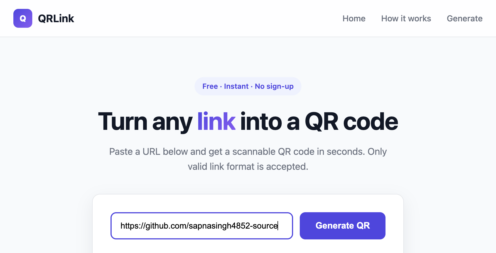

# QRLink — Link to QR Code Generator

A small website that takes a link as input, accepts **only valid link format**, and generates a QR code for it.



## Try it

```bash
cd qrlink
python3 -m http.server 8000
```

Then open http://localhost:8000 — or just open `index.html` directly in a browser, since everything runs client-side.

## How it works

1. Type or paste a URL into the input.
2. The value is validated in the browser. Anything that isn't an `http://` or `https://` URL is rejected with an inline error and no QR code is produced.
3. A valid link is rendered into a QR code on a `<canvas>`, which can be downloaded as a PNG.

Validation lives in `index.html`:

```javascript
function isValidLink(value) {
  try {
    const url = new URL(value);
    return url.protocol === 'http:' || url.protocol === 'https:';
  } catch {
    return false;
  }
}
```

## Files

| File | Purpose |
|---|---|
| `index.html` | The whole site — markup, styling, validation and QR logic |
| `qrcode.standalone.js` | Bundled [`qrcode`](https://www.npmjs.com/package/qrcode) library |

## Notes

- No build step, no framework, no network calls — the QR library is bundled locally so the page works offline.
- Input is trimmed before validation, and the error clears as soon as you edit the field.
